# Reviewer illustrated handbook

Version: 2026-10-16.2

> Generated from `leadtrace/frontend/src/review/help/reviewer-guide.json`. Edit that source and run `python leadtrace/ops/reviewer/render_guide.py`.

## 01 · Your first paper

Your task is to turn paper content into traceable, checked records. AI prefill is a draft. Keep uncertainty visible and ask your supervisor when chemistry is unclear; do not guess to finish.

1. Sign in with the supplied Reviewer account and open an assigned paper from My tasks. Match the title and DOI. A Preview banner identifies the preview environment; distinguish training from real assignments.
2. Read the abstract, main figures/tables, synthesis schemes and conclusion to identify the target, starting compounds and authors’ priorities. You do not need to edit every field immediately.
3. Follow Article information → Compounds and structures → Lineage → Review & submit. Start with one Compound: label, structure, source image and Activity; then inspect its Lineage and Edges.
4. Work on one item at a time. Save and verify the updated display. Placeholder examples are not paper data and must not be saved as facts.
5. Check uncertainties and sources for each group before checking whole-paper coverage and submission. Practise in a training assignment supplied by your supervisor, never by inserting this guide’s fictional molecules into a real paper.

> Screenshots show the real workbench with fictional teaching data. Values, labels and research statements illustrate operation only. Screenshots match each guide’s interface language; common field names are retained for comparison.

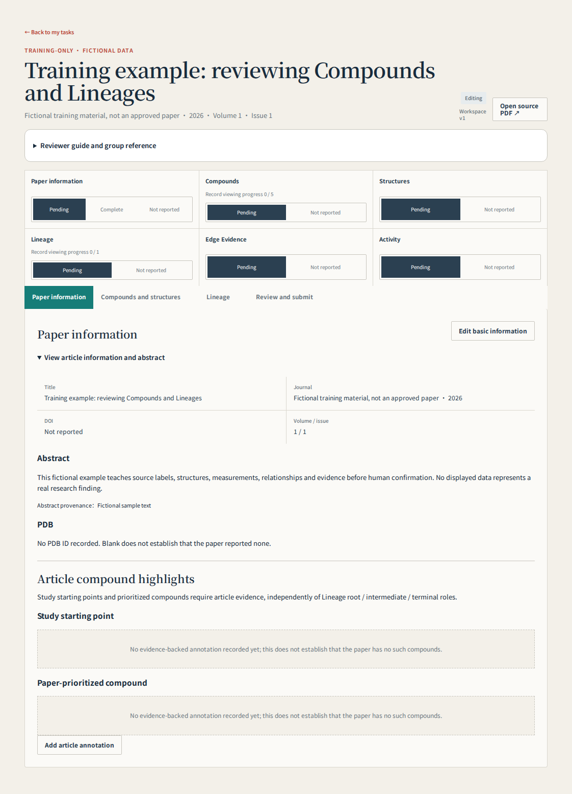

Find the five main tabs: Article information, Compounds and structures, Activity comparison, Lineage, and Check and submit. Section status, viewing progress and scientific review status serve different purposes, explained below.

Undo / redo restores saved edits and appends history. Save or cancel pending local edits first. Other sessions, AI updates, submissions and workflow changes stop the older undo chain to protect newer content.

## 02 · Eight objects to recognize

Separate molecular identity, measurements, relationships and supporting sources before entering data.

| Object | Plain meaning | Where it belongs / example |
|---|---|---|
| Paper / Workspace | A paper / its review workspace | Keep records for the same paper together |
| Compound | An identified compound in the paper | Label 7a, 24 or an explicit author label |
| Structure | The chemical structure for that identity | Atoms, bonds, attachment positions and stereochemistry |
| Activity | One measurement for that molecule | An IC50, solubility or other assay result |
| Lineage | Compounds grouped by design or synthesis logic | An SAR series or a synthetic route |
| Node / Member | A Compound participating in a Lineage | Select an existing Compound, not a duplicate molecule |
| Edge | A relationship between two members | A → B comparison or synthetic transformation |
| Evidence | Source supporting or explaining a record | PDF page, exact quotation or table/figure region |

A Compound may have several Activities and participate in several Lineages. The same molecule can be a synthesis product and an SAR comparison member; reuse the Compound in both groups.

## 03 · Start with article information, then inventory compounds

Verify title, DOI and PDF. Include every numbered or labelled Compound with a determinable structure, including starting materials, intermediates and controls without activity data. Examples illustrate format and are not paper facts.

Start with the Article information tab. It contains bibliography and Abstract, six research-information modules, and article-level compound annotations. Establish the study scope before reviewing Compounds and Lineages; detailed field guidance is in sections 12–13.

| Area | How to read and edit |
|---|---|
| Bibliography and Abstract | Verify title, journal, year, DOI, PMID / PMCID and the original abstract. Use Edit bibliography; provenance and abstract check state are in bibliographic traceability details. Expand long abstracts. |
| Six research-information modules | Molecule types, mechanisms, targets and genes, optimization goals, disease context, and PDB. Desktop modules use two columns and independent scrolling. Use Edit bibliography and expand the relevant module to edit. |
| Evidence and sources | Expand evidence/identifier details to inspect quotations, locations and hints. Use the source-page or source-region controls; if no crop button is available, check the source link and page. |
| Article-level compound annotations | Study starts, hub compounds and paper-prioritized compounds. Create the Compound and source Evidence first, then Add article annotation and choose compound, role, scope, support and review status. |
| Saving and section confirmation | Check the saved display. AI prefill, opening the page or saving an edit does not establish section review. Check new content and uncertainties, then explicitly confirm through the section review controls. Blank does not automatically mean unreported. |

1. Match the title, DOI, journal and year, and confirm that Source PDF belongs to this paper. Stop work on a mismatched source and report it.
2. Use the PDF viewer’s physical page number, starting at 1. A printed journal page such as 3456 is not PDF page 3456. Record the physical page together with Table 2 or Scheme 1.
3. Inspect text, tables, figures, schemes, experimental methods and available supplementary material. Inventory each source label, location, determinable structure, presence in the workspace and uncertainty.
4. Audit label ranges individually, for example 24–31 and 55–73. Consecutive labels do not imply similar structures; a numbering gap is a reason to inspect the source, not proof of an omission.
5. Include identifiable, structurally defined starting materials, intermediates, controls and comparison compounds. Lack of Activity does not exclude a Compound.

> If only a label is known and no complete structure can be established, retain the label, source page and gap in your issue log for the supervisor; do not copy a neighboring structure. A complete source-supported candidate with a specific uncertainty may carry a verification hint. Record unavailable SI as a coverage limit rather than claiming exhaustive coverage.

## 04 · Compound labels and identity

Keep source labels such as 24 or 7a; display name is optional. Each Compound has one Structure. Verify connectivity, substitution and stereochemistry after entering SMILES or using the structure editor. Explain unresolved identity rather than inventing a structure.

| Field | What to enter | Common mistake |
|---|---|---|
| Compound label | Keep source labels and meaningful distinctions such as 7a or (R)-24 | Replacing source labels with your own sequence |
| Display name | An author alias or established name; leave blank if absent | Interpreting a number in an alias as the paper label |
| Description | Purpose, source, series and why no Lineage applies | Writing only “none” without an explanation |
| Verification hint | Specific uncertainty, source location and what must be checked | Vague “AI may be wrong” or clearing it before resolution |

1. Select a source label on the left and confirm the detail panel shows the same compound. Before Add Compound, check whether the label already exists.
2. After saving the label, complete structure and source checks. Use Edit for purpose and uncertainty notes. Identical-looking structures alone do not justify merging author-distinguished identities.
3. Stereoisomers, salts, tautomers and reused labels require care. Follow explicit author identity and structure; ask your supervisor before normalizing unfamiliar cases.

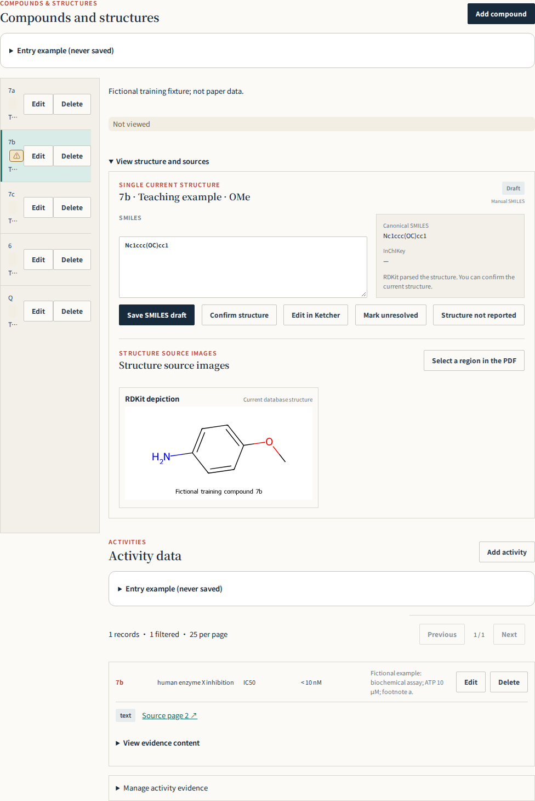

The left panel lists this paper’s Compounds; the right panel contains the selected structure, sources and Activities. Check one label at a time to avoid mixing neighboring records.

Copy the current Compound, then paste as a new record. Identifier and display name start blank. A duplicate identifier blocks saving; a duplicate display name only warns. The copy includes structure, source images and Activities; its structure is Draft, with no copied Lineage membership, article highlights or viewed state.

## 05 · Structure review: check the molecular graph

You can learn to compare drawings before learning to write SMILES. Do not mark a structure confirmed when you cannot assess it. Focus on which atoms and bonds are connected.

1. Locate the exact labeled drawing or shared scaffold plus the compound-specific substituent row. R, R¹ and R² are variables, not resolved atoms.
2. Trace each ring and count atoms; distinguish five- and six-membered rings. Fused rings share an edge, spiro rings one atom, and bridged systems have different connectivity. Overall shape or a similar name is insufficient.
3. Check atom identity and position: C, N, O and S. Moving one aromatic N changes the molecule. Unlabeled skeletal vertices usually represent carbon; read the drawing conventions carefully.
4. Follow each attachment from the scaffold: Me versus OMe, Ph versus Bn, chain length and ortho/meta/para position. Bn adds CH₂ relative to Ph; OMe adds O relative to Me.
5. Check single/double/aromatic bonds, carbonyl location, formal charges, explicit hydrogens, salt components, wedges/dashes and E/Z. Do not assign stereochemistry that the source leaves unspecified.
6. Inspect the regenerated drawing after saving. Different SMILES can describe the same structure; parser acceptance establishes readable syntax, not source correctness. Set the structure disposition only after review.

Both input methods save the same Structure. After drawing in Ketcher, choose Save Ketcher Draft. When parsing succeeds, the SMILES field automatically shows the generated result and the RDKit depiction updates to the saved structure; no manual copy or second SMILES save is needed. Editing SMILES and choosing Save SMILES Draft also updates the depiction. The image represents saved content, not unsaved typing; an invalid draft has no usable depiction and needs correction. Saving a draft is not scientific confirmation: check the source before Confirm Structure.

| Status | Meaning / when to use |
|---|---|
| draft | Entered or prefilled, not yet fully checked |
| reviewer_confirmed | You verified the current structure against its source |
| unresolved | Source ambiguity or a problem you cannot resolve; explain it |
| not_reported | The source does not report the structure information; do not use merely because you cannot find or draw it |

> Ring size, heteroatom position and attachment points are frequent beginner errors. Keep a specific unresolved note if any cannot be checked. A generic scaffold crop also requires the matching substituent row.

> Actual button behavior: Mark unresolved and Structure not reported clear the current SMILES / Molfile and save a no-structure disposition. If a complete candidate has a specific uncertainty, retain the Draft and explain it in the Compound verification hint. These buttons are not simple warning toggles. Preserve sources and an issue record and consult your supervisor before choosing a no-structure disposition.

Enter an IUPAC name to convert locally with OPSIN. Check the result in the editor, save a Draft and confirm separately. Failed parsing does not replace the saved structure.

## 06 · Activity: entering a measurement

Fictional example: Assay = human MAO-B inhibition; Metric = IC50; Operator = <; Value = 10; Unit = nM; Context records assay conditions. Do not put <10 nM entirely in Value or combine different assays. Preserve units and qualifiers.

Activity comparison builds a read-only table from chosen columns. Choose Add column, find an existing exact assay/metric/unit measurement, and enter a display title. All records includes future matching additions. To separate conditions, choose Selected records only, filter the preview by literal condition text or Compound identifier, then check records or choose Select filtered records. Search only changes the preview; renaming never changes the linked measurement or conditions. Show Compounds with records in any column or every column. Drag column cards or use left/right buttons to reorder, edit or remove columns. All repeated observations remain without averaging or conversion. Name and save multiple tables per paper. Configurations are local to this browser, account and paper, with no cross-device synchronization. Only settings are saved; values always come from current Activities. Explicit selections exclude newly added records and unavailable links are flagged. Click a Compound or value to open the matching editor; save or cancel edits before returning to the current columns, filters and scroll position. Browsing and configuration do not mark Viewed or Confirm or modify scientific records.

| Field | Fictional example | How to read it |
|---|---|---|
| Assay | human enzyme X inhibition | Target and assay system, not just “activity” |
| Metric | IC50 | Endpoint, distinct from Ki, EC50 or percent inhibition |
| Operator | < | Preserve the reported inequality |
| Value | 10 | Numeric value only |
| Unit | nM | Source unit; 1 μM = 1000 nM |
| Context | Biochemical assay; ATP 10 μM; Table 1 footnote a | Retain conditions, replicates, uncertainty and qualifiers |
| Evidence | PDF p. 2, Table 1, row 7a | Link a source that locates this measurement |

IC50 usually denotes the concentration producing 50% inhibition; lower values generally indicate stronger inhibition within the same assay. EC50, Ki, Kd, viability, solubility and exposure answer different questions. Even IC50 values from different targets, species, cell lines, times or conditions are not automatically comparable.

1. Confirm the selected Compound before Add Activity. Save separate records for separate assays rather than overwriting a different measurement.
2. Read the row label, column heading, units and footnotes together. For 12 ± 3 nM, enter 12 as Value and preserve ±3 and its stated SD/SEM meaning in Context; never guess the error type.
3. ND, NT and inactive are not numeric zero. Preserve their reported meaning and conditions in notes/evidence; ask your supervisor if the numeric form cannot represent them faithfully.
4. After saving, open the evidence and verify the crop contains the right compound, endpoint and units.

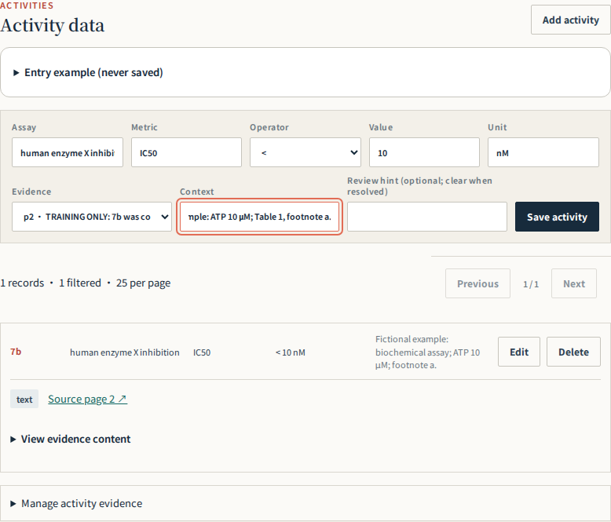

Fictional <10 nM example: enter operator, number and unit separately, retain conditions in Context and link source Evidence.

## 07 · Evidence and crops: make records traceable

Verify relationship type, endpoints and modification summary. Fictional format example: Me → OMe, comparing lipophilicity; relationship inferred from structures, not explicitly stated by the authors. Distinguish source support from inference; table order is not optimization order. Evidence retains exact quotations, actual PDF page and region. supports/contradicts/contextual describe evidence roles. Viewing never changes draft to reviewer_confirmed.

Evidence provides a checkable source. Use quoted text for verbatim wording, Caption for Table/Figure/Scheme identification, and Reviewer note for interpretation, translation or inference. Do not present your interpretation as an author quotation.

1. Open Evidence from the Activity area or Add / edit relationship evidence in a Lineage. Reuse existing evidence where appropriate.
2. Check the PDF page and orientation before selecting a region. For an Activity table, include the compound row label, endpoint heading, unit and relevant footnote. Avoid illegibly broad or context-free tiny crops.
3. Inspect the generated image after saving, not just the selection rectangle. Verify label, endpoint, value, unit and footnote against the intended row and column.
4. For blank, shifted or neighboring-result crops, correct the source page/region. Retry generation when offered, but retrying cannot repair incorrect coordinates.
5. For Edge evidence, supports, contradicts and contextual mean support, contradiction and background. A passage may support only one relationship; do not automatically attach it to every edge.

> A missing generated crop does not mean missing source data; an existing image does not prove correctness. A table spanning pages may require several source locations, which should be identified in the reviewer note.

## 08 · Lineage: how to construct each graph

Build each SAR Lineage around a common starting point or baseline, a clear optimization theme, and supported relationships. Define the question the graph answers before choosing nodes and edges. Keep exploration around the same baseline together; prefer splitting at a hub compound when it becomes the baseline for a new optimization group. Build synthesis Lineages separately from actual precursor-to-product routes, without mixing in SAR design relationships.

| Category | Question answered | Possible source support | Avoid |
|---|---|---|---|
| SAR | How were structures designed/compared to explore properties? | Design statements, structural comparisons, comparable assays and scope | Automatically chaining labels 1→2→3 |
| synthesis | Which precursors give which products? | Scheme arrows, methods and explicit multistep paths | Treating improved activity as synthesis |
| Isolated control | Why is this molecule present without an optimization relationship? | Initial comparisons or an external reference standard | Inventing an edge merely to connect every node |

1. Choose the graph category first. SAR graphs express design evolution or structural comparison; synthesis graphs express actual chemical transformations. The same Compound may occur in both categories, but do not mix the two kinds of edges into one optimization route.
2. Write the graph’s question first: which compound or supported common baselines start the group, which site/scaffold/property problem is explored, and which compounds are compared? For example, “Side-chain optimization from 3 to explore metabolic stability.” The name and description should explain this scope.
3. Select members for that question. Include supported members of the exploration group, including unsuccessful and non-prioritized compounds. Do not automatically place an entire paper, table or set of similar structures in one graph. Keep compounds without supported relationships in the Compound catalog.
4. Establish direct relationships individually. If 2, 3 and 4 all use 1 as baseline, draw 1→2, 1→3 and 1→4. If 5 and 6 are designed from 3, connect them from 3. Check each edge’s endpoints, direction, meaning and Evidence; labels, potency rankings and structural resemblance do not establish optimization chronology.
5. Then decide whether to split. Prefer one graph for exploration around the same baseline and theme. Independent themes forming complete branches may be split; prefer splitting at a hub compound when it starts a new optimization group. Keep short chains together, and usually retain branches with extensive cross-comparisons or convergence in one graph. See the decision table below.
6. Finally audit continuity and completeness. Reuse the same Compound across graphs, describe the adjoining Lineages and hub compound, and check for missing members, edges or evidence. Do not invent or duplicate relationships to connect or populate graphs. Arrange the compact graph only after establishing the science.

```text
Description template for each SAR graph (complete from the source)
Shared start / baseline: Compound …
Optimization theme: …
Member scope: … (series, site or relevant tables/figures)
Edge support: explicit author design relationships / scoped SAR comparisons; Evidence …
Connections: Compound … is the hub linking from/to Lineage …; state not applicable if no connection exists.

If the baseline or theme cannot be explained, revisit grouping. If relationship support is missing, retain uncertainty rather than using layout to manufacture a complete route.
```

> The key split criterion is a new optimization baseline followed by a new group of exploration, not every new table, objective or branch. One root may support several branches, and a graph may have several source-supported roots.

| Situation | Recommendation | Rationale |
|---|---|---|
| One start, one site/theme, a batch of substituent changes | Keep together | Retain the common baseline and parallel comparisons. |
| One start, distinct sites/scaffolds, each forming an independent optimization group | May split by branch | Each group needs its own theme and scope; a single substituent change is insufficient. |
| One or several compounds selected from a batch each start another optimization batch | Prefer splitting at the new baseline | Keep incoming relationships in the preceding graph; reuse the compound as root in the next. |
| A continuous two- or three-step chain without a separate new exploration batch | Usually keep together | An intermediate can also serve as a hub compound. |
| Branches depend on cross-comparisons, convergence or many cross-group relationships | Prefer keeping together | Do not obscure key connections; each relationship still needs support. |
| Only a different Table/Scheme, more nodes, or an objective shift from potency to PK | Insufficient on its own | Check the baseline, theme and relationships; address crowding through layout first. |

```text
Fictional split: the authors compare 1→2, 1→3 and 1→4, then select 3 for a batch of side-chain optimization.
Graph A: 1 (root) → 2, 3, 4 (local terminals)
Graph B: 3 (root) → 5, 6, 7 (local terminals)
3 is the hub compound; both graphs use the same Compound.
If the authors prioritize 6, add its paper-prioritized article annotation; do not infer it from terminal position.
```

Audit members, edges and evidence before and after splitting: keep 1→3 in A and 3→5/6/7 in B. Do not omit edges or duplicate a scientific relationship just to populate both graphs. Name the shared compound and adjoining Lineages in their descriptions. Add existing Compounds as nodes rather than copying identities, structures or Activities. Merge groups if splitting prevents clear retention of real cross-group relationships. Preserve unsuccessful and non-prioritized branches; compounds without supported relationships may remain in the Compound catalog.

```text
Fictional SAR example
7a (Me) → 7b (OMe)
7a (Me) → 7c (F)
A stated common reference; arrows represent supported comparisons, not synthesis of 7c from 7b.
```

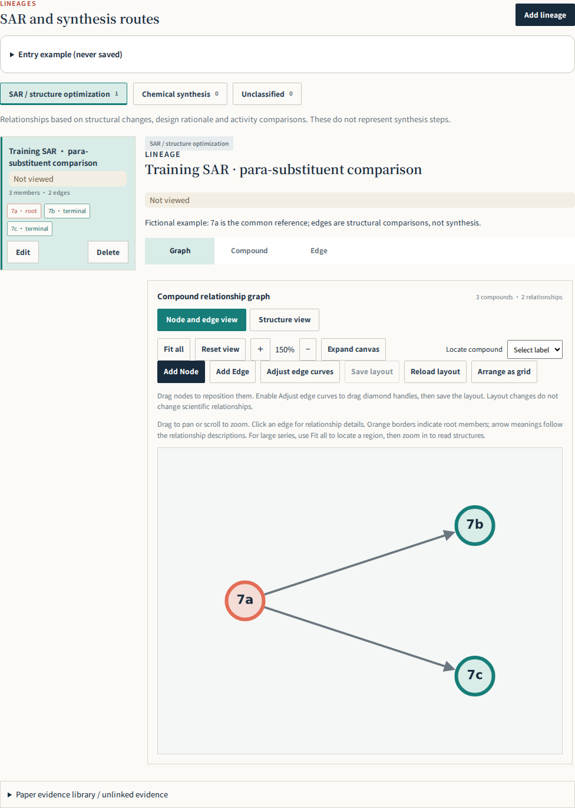

A branching example Lineage. Check its category and grouping rationale, then members and the support for each edge. Node position is presentation only.

> The five cases below are entirely fictional and captured from the real Reviewer point-and-arrow interface. Numbers are teaching labels; assume explicit author support for the stated design/comparison relationships. Never infer real-paper relationships from these numbers or graph shapes. Confirmed annotations are also fictional teaching states. Open screenshots for full-size viewing.

Case 1: one baseline and one theme belong together. Suppose the authors compare side-chain analogues 2, 3 and 4 against 1 in parallel. Retain 4 even if it did not improve. Draw 1→2, 1→3 and 1→4, not a sequence 1→2→3→4.

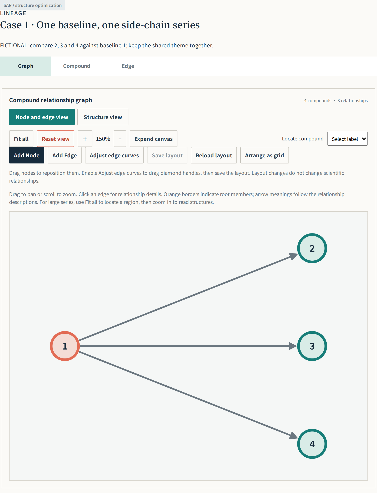

Case 1 · One optimization batch from a common baseline: parallel branches from one root, including unsuccessful compounds.

Case 2: a selected hub starts a new optimization batch, so prefer successive graphs. Suppose the first batch is 1→2/3/4; the authors select 3 and design 5, 6 and 7 from it. In A, 3 is terminal; in B, the same 3 is root and carries the Hub compound annotation. If 6 is prioritized, mark that separately. Reuse Compound 3; keep 1→3 in A and 3→5/6/7 in B.

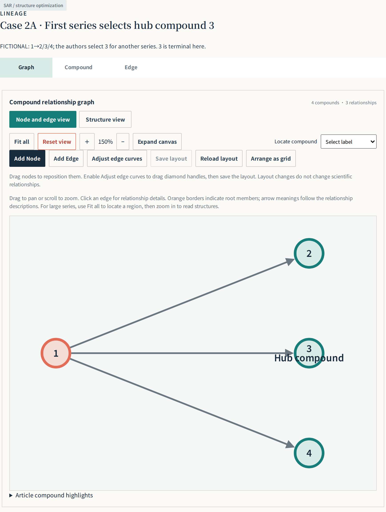

Case 2A · Earlier graph: 3 is a local terminal and the hub leading into the next exploration group.

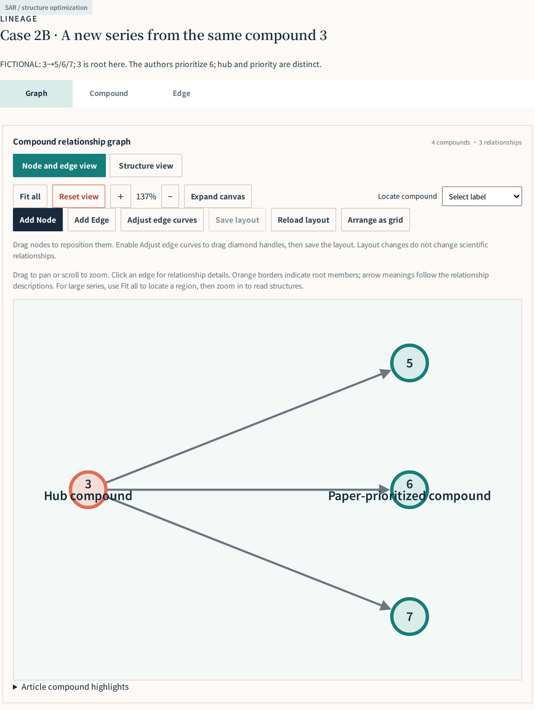

Case 2B · Later graph: reuse 3 as root; assess the paper-prioritized annotation for 6 independently.

Case 3: independent optimization themes from the same root may be separated. Suppose 10→11/12 explores side chains, while 10→21/22 explores ring replacement. Each has an explicit design rationale and no cross-comparison requiring joint reading. Reuse 10 in separate graphs. Different labels or tables do not justify the split; independent optimization questions do. Multiple branches alone do not make 10 a hub compound.


Case 3A · Side-chain optimization: baseline 10 with members 11 and 12.

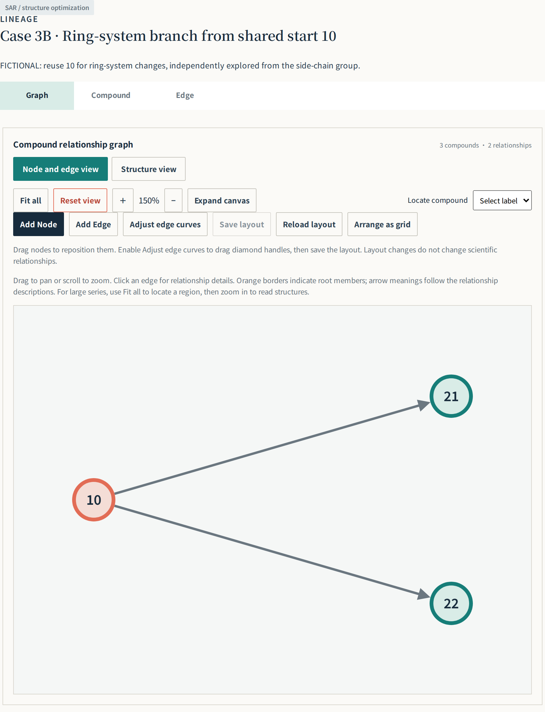

Case 3B · Ring-system optimization: the same baseline 10 with independent members 21 and 22.

Case 4: keep a short continuous progression around one question together. Suppose 30 leads to 31 and then 32, both steps addressing the same side-chain problem with no independent new exploration batch. Keep 30→31→32. The local role of 31 is intermediate; an outgoing edge alone does not justify a hub annotation. If the source explicitly supports hub significance, assess that separately from whether to split.

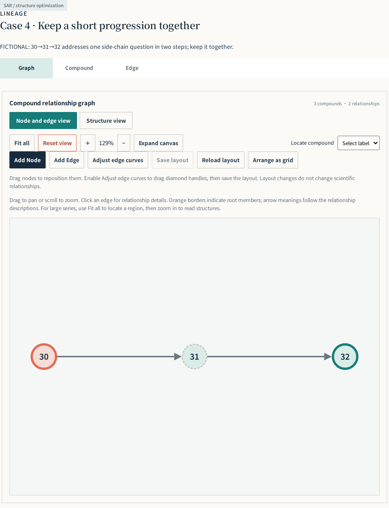

Case 4 · Two design steps remain one graph; not every intermediate must start a new graph.

Case 5: retain important cross-comparisons or convergence in one graph. Suppose 40 leads separately to 41 and 42, and the authors explicitly compare 43 against both in SAR, with support for each relationship. Keep 41→43 and 42→43 visible. The incoming edges do not claim that 41 and 42 jointly synthesize 43; an actual reaction belongs in synthesis. Do not delete a relationship to force a tree, or invent two edges merely because 43 resembles both.

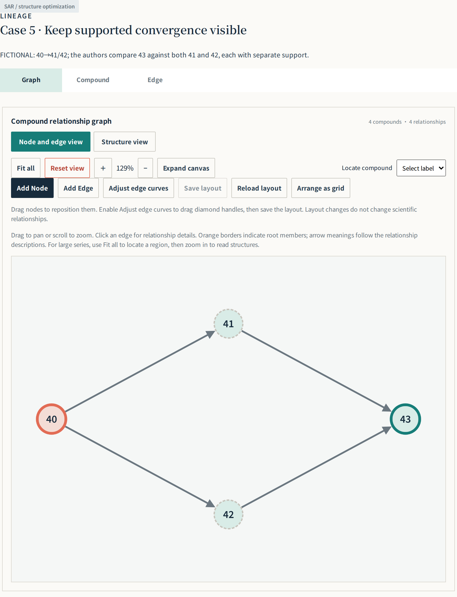

Case 5 · Two independently supported relationships reach 43: retain convergence rather than forcing a tree.

Search a Compound identifier or name to find its Lineage and focus the node. Paste a copied Lineage with a new name: it reuses Compounds and Evidence but creates independent members and Edges with Draft review status. Duplicate Lineage names show a warning.

## 09 · Local roles versus article annotations

Root / intermediate / terminal describe local graph position. A root may be an original start or a hub compound inherited from an earlier group; terminal means only the end of this graph. Hub-compound significance describes design use, while paper-prioritized compounds use the existing article annotation. Check position, use and author choice separately; they can coexist.

| Name | How to decide | Does not mean |
|---|---|---|
| root | A local starting point or comparison baseline, either an original start or a subsequent start selected earlier; multiple roots are allowed | Automatically a study starting point |
| intermediate | An internal node, typically with incoming and outgoing relationships | Automatically a synthetic intermediate in an SAR group |
| terminal | A local endpoint with no outgoing edge in this graph; optimization may continue in the next graph | Best potency, final medicine or author-prioritized compound |
| unspecified | Role not yet determined; further review needed | A permanent shortcut around review |
| Study starting point | An author-supported starting molecule for this study/series | Every reagent or first material in a synthesis |
| Paper-prioritized compound | A molecule the authors explicitly choose to advance, with rationale | Every terminal or the reviewer’s lowest-IC50 choice |
| Hub compound | Source-supported baseline for a further optimization group; compatible with root / intermediate / terminal position | Not every node with an outgoing edge, and not automatically paper-prioritized |

> A hub compound is a molecule the authors select during the study as the baseline for a further optimization group. “Hub” describes its role in the design process, not its number of graph connections. It need not have multiple branches, the best potency or final prioritized status.

The same Compound can have different roles in different Lineages. A study can have several starts and priorities, and one molecule may carry both annotations. The key is the authors’ scope and rationale, not row order.

> The website supports a separate Hub compound article annotation. Under Article information → Add article annotation, select this role, link the existing Compound, specify the subsequent series/Lineage scope and author rationale, and choose source Evidence. The annotation appears with the compound in Compound views and Lineage graphs; it does not automatically split graphs or change root / intermediate / terminal. Describe links between successive groups in their Lineage descriptions. One compound may carry study-start, hub-compound and paper-prioritized annotations, each with explicit support.

## 10 · Editing a Lineage in graph and forms

Switch between three tabs. Add Node selects an existing Compound from this paper; create missing Compounds on the compound page first. Add Edge selects source then target before opening the relationship form. Drag nodes or diamond control handles and Save layout. Point and structure modes save separately. Reload layout discards unsaved layout in that mode. Full forms remain available.

1. Select the correct SAR / synthesis category and Lineage, then switch Graph / Compound / Edge; each tab uses the main work area.
2. Choose Add Node on the canvas, find an existing Compound and select its local role. If the label is absent, first check whether it is already a member; create a genuinely missing Compound on the compound page.
3. Choose Add Edge, then source and target as prompted. In the Edge form recheck both labels, direction, relation type, modification summary and evidence. Cancel before saving to avoid creating a relation.
4. Alternatively add a Member in the Compound tab and use full forms in the Edge tab. Both interfaces edit the same records.
5. Drag nodes; enable edge bending to drag diamond control handles. Choose Save layout. Point and structure modes keep separate layouts.
6. Reload layout discards unsaved positions in the current mode; grid rearrangement changes presentation. Moving nodes or bending edges does not change endpoints or scientific review status.

For an overview, start with compact nodes and arrows: place starts on the left, subsequent optimization to the right and parallel analogues vertically. Inspect structures in Compound details. Layout does not establish relationships: comparisons of 1 against 2, 3 and 4 form a branch, not 1→2→3→4. If 3 is the direct baseline, connect its derivatives from 3 rather than from the original 1. Retain supported convergence and multiple parents instead of forcing a tree.

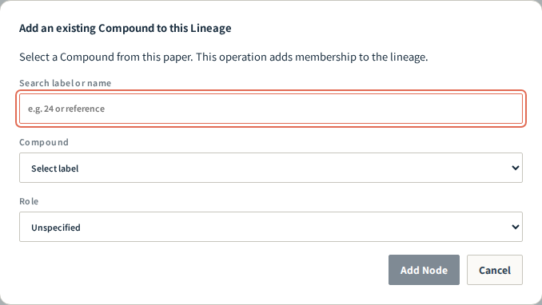

Add Node selects an existing Compound from this paper. Its role belongs to the current Lineage; verify the label before confirming.

## 11 · Edge: what changed and what supports the link

Each edge needs interpretable endpoints, direction and meaning. Separate structural differences, measured results, author explanations and reviewer inference.

| Check | Recommended approach |
|---|---|
| Endpoints and direction | Read Parent / Child labels first. Synthesis normally goes precursor→product. Explain SAR direction using a supported reference/design relationship, not assumed chronology. |
| Relation type | Use the actual relationship; distinguish SAR comparison from synthesis. The type does not replace a full explanation. |
| Modification summary | Fictional: para Me replaced by OMe on the same scaffold; IC50 changes from 120 to 40 nM in the same assay. |
| Claim boundary | Stronger inhibition in that assay is supported; an unmeasured logP change is not a measured fact. |
| Inference labeling | Fictional: comparison inferred from structures; author optimization order not stated. 7a is the reference, with no synthesis claim. |
| Disposition | After checking sources explicitly choose draft / reviewer_confirmed / unresolved and retain conflicts. |

Keep graph labels short and specific to the edge, such as “side-chain replacement” or “ring contraction.” In relationship details, distinguish the structural change, optimization goal and observed result, and verify this edge’s endpoints and evidence. Do not apply one edge’s explanation to the whole group. Shared table membership, structural similarity or potency ranking do not establish optimization chronology.

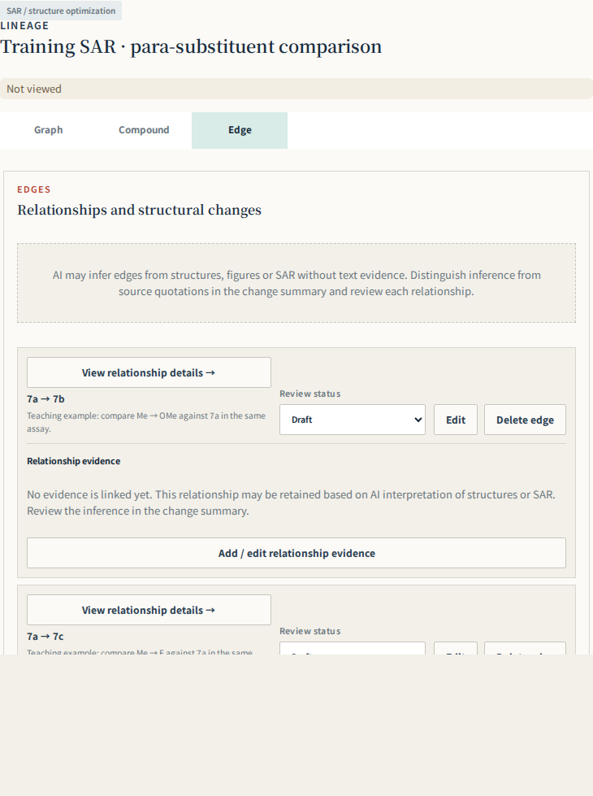

Use the Edge tab to check endpoints, meaning and disposition one relationship at a time. Sources justify the edge; a tidy graph does not.

## 12 · Support study starts, hub compounds and prioritized compounds

On the article information page, link a Compound and existing Evidence, record its study-start, hub-compound or paper-prioritized role, study/series scope and author rationale. Multiple compounds and coexisting annotations are allowed. Save source support in the Evidence library first; cards retain the PDF page and quotation. A study start is not every synthesis reagent; a prioritized compound is not every terminal or the lowest IC50. Draft, confirmed and unresolved states remain visible. Viewing never confirms; unrecorded does not mean absent. Recheck after changing identity, rationale or source, and explicitly clear resolved verification hints.

1. Read the Introduction, Results/Discussion and conclusion for explicit starting-point or advancement statements; verify labels and aliases against figures/tables.
2. Save the quotation and physical PDF page in Evidence, then choose Add article annotation on Article information.
3. Select the Compound, role, scope (whole study or Series A), author rationale and source Evidence. Potency, selectivity, PK, brain exposure or in vivo effects belong in the rationale only when supported.
4. Confirm only after verification. Use unresolved with an explanation for identity/support conflicts. Recheck after changing identity, rationale or evidence rather than carrying forward the old judgment.

Use Hub compound when the source explicitly selects a compound as the baseline for another optimization group. Name the subsequent series or Lineage in Scope, explain the choice and exploration in Rationale, and link Evidence supporting that transition. An outgoing edge alone is insufficient. Draft annotations require explicit human confirmation or an unresolved disposition with a specific issue. Do not duplicate the same compound, role and scope; a distinct scope may have its own annotation.

> The most potent in vitro compound may have been abandoned for poor exposure. An external drug comparator appearing in Figure 1 is not automatically a study starting point.

## 13 · Article information: abstract, molecule types, targets and evidence

Check bibliographic identity, source abstract, molecule types, mechanisms, targets and genes, optimization goals, disease context and PDB references. AI supplements still require review. Modules scroll independently and evidence/crops start collapsed; expand them to check all content. Empty means unrecorded, not unreported by the paper.

| Module | Checks |
|---|---|
| PMID / PMCID | PMID is numeric; PMCID includes the PMC prefix. Open links and match title, DOI and year; do not use another paper’s or a cited reference’s identifier. |
| Molecule types | Choose existing terms. A nonempty classification needs at least one primary type; supplementary features may be combined. A macrocyclic inhibitor uses Small-molecule inhibitor + Macrocyclic; an allosteric inhibitor uses Small-molecule inhibitor + Allosteric modulation. Avoid duplicate terms; explain newly selected Other / Unclear entries. |
| Mechanisms | Record source-supported mechanisms and distinguish evidence from hypotheses. A molecule-type label alone does not establish a mechanism. |
| Targets and associated genes | Check target name, study role, organism, gene symbol and UniProt / NCBI Gene identifiers. Distinguish primary targets, selectivity controls, off-target assays, mechanistic targets and biomarkers. Do not classify an entire assay panel as primary targets or infer genes/species from abbreviations. |
| Optimization goals / disease context | Distinguish intended property improvements from achieved results, and intended applications from demonstrated therapeutic effects. Keep support for each entry. |

> The side-by-side modules scroll independently; review beyond the first visible screen. Expand evidence or identifier details to read quotations; the editor also has a source-quotation section. View source region appears only when crop coordinates match the current main PDF. Without that button, use the source-page or source link; reading a quotation is not viewing the source image. Identify supplementary material and page, retain external links, and keep quotations faithful while putting explanations in the rationale.

PDB IDs support the traditional four-character and extended pdb_ formats; a three-character ligand code such as ATP is not a PDB ID. Distinguish structures from this work, cited structures and unknown usage; retain pages and context, and link a Compound only when the source explicitly pairs it with the structure.

1. Use Edit bibliography for the source Abstract; its source and check status are under bibliographic traceability details. A translation or summary cannot replace the original abstract. Extracted does not mean reviewer-confirmed; explain scope and reasons for Not found or Needs review.
2. Search text, structure methods and Accession Codes for Protein Data Bank / PDB. Distinguish structure accessions from three-character ligand codes, gene accessions and equipment codes.
3. Use this-work for newly determined/deposited experimental structures; cited-structure for existing coordinates used in docking, comparison or molecular replacement. Explain uncertain usage.
4. Record the physical PDF page and context. Associate a Compound only with explicit source support: docking compound 7 does not establish that the deposited crystal ligand is 7.
5. Usually consolidate repeated mentions of one ID with uses and additional page references. Retain and flag source conflicts rather than silently substituting a more plausible accession.

If no accession is found, state the actual scope, such as “No explicit PDB accession found in this PDF; SI not checked,” when true. An empty field alone does not establish source absence.

## 14 · Viewed is not confirmed

Viewing is recorded only for Compound and Lineage groups. Explicitly select a Compound or Lineage (including opening its Edge details); background loading or viewing the graph does not mark every group. A Compound includes its fields, structure, source images, activities and linked evidence. A Lineage includes members, their Compound content, edges and linked evidence. Related edits invalidate the affected groups; unrelated groups remain unchanged. Groups can be marked unread. Only these two counts are shown; Structures, Activities, Edges and Evidence have no separate viewing checkmarks. Article information retains its manual section confirmation. Unassigned Evidence remains in the evidence library and is covered by the final whole-paper confirmation. Historical narrow-scope receipts do not establish group viewing: reopen the current group. Text accompanies colors. Viewed is not scientific approval, never clears verification hints, and never confirms Structures or Edges. Empty sections still need an explicit not-reported disposition. Final human confirmation, submission and Admin approval remain required.

| Signal | Meaning | Your remaining responsibility |
|---|---|---|
| Compound / Lineage viewed | You explicitly opened this group at its current content version | Inspect all relevant contents; the automatic receipt does not prove understanding |
| ⚠ Needs verification | A specific issue is attached; click to expand | Resolve against the source and explicitly clear the hint; viewing/confirmation does not clear it |
| draft | Scientific disposition is not complete | Decide whether the structure, relationship or annotation is supported |
| reviewer_confirmed | An explicit scientific judgment by the reviewer | Recheck support after content changes |
| unresolved | An explicitly recorded open problem | Explain and hand off; this is not confirmation of correctness |
| Section not reported | Source absence determined through review | Document why; do not use to bypass unfinished work |

Viewing is tracked only at Compound and Lineage level. A Compound group includes structures, source images, Activities and linked evidence; a Lineage group includes members, member content, Edges and evidence. Relevant edits invalidate viewing, while layout changes do not change the science. Do not click through simply to fill the count.

After checking the current Lineage graph, click “Confirm all Draft Edges” without opening each Edge. Only Draft Edges in this Lineage become confirmed; unresolved statuses and review hints remain. The current Lineage is marked viewed, while Compound structures and member roles stay unchanged. The batch supports one-step undo and redo; changed or restored records need to be viewed again.

## 15 · Before submission: resolve each blocker

Submission freezes the current content for Admin review. Your final whole-paper confirmation is still required; passing automated checks does not replace source review.

1. After reviewing groups and their scientific dispositions, open Review & submit and choose Recheck.
2. Open unread groups and inspect the current content after edits. Article information retains manual section confirmation. Check unassigned Evidence in the library as part of the final whole-paper review.
3. Open each blocker and fix the actual issue: a draft structure/edge, incomplete Lineage roles, unsupported article annotation or stale viewing receipt. Never bulk-confirm just to pass.
4. Explicitly mark genuinely unreported empty sections. Explain unresolved issues and coverage limits in Reviewer note. If submission with unresolved items is permitted, make them clear to Admin; submission does not resolve them.
5. Recheck coverage, structure sources, Activity units, Lineage logic and uncertainties. When ready for handoff, manually check the final confirmation and submit to Admin.
6. A successful submission is frozen. Admin can approve or request changes; publication follows approval. Use the return-for-changes workflow for corrections rather than creating a duplicate paper.

| After submission | What to do |
|---|---|
| Returned for changes | Return for changes reopens the same workspace without clearing saved content, human notes or unchanged confirmations. You do not restart from an empty paper. Read the return reason, recheck changes, dependencies and invalidated viewing receipts, then complete the whole-paper confirmation before submitting again. |
| AI supplements | AI article supplements do not count as human Reviewer edits, but remain current content requiring review. Additions after submission require relevant checks and resubmission; approval of an older submission cannot approve new content. |
| Resubmission | Admin navigates actual Reviewer submissions with timestamps, notes and version comparisons; saving a draft alone creates no new submission. Explain completed corrections and unresolved issues in the Reviewer note when resubmitting. |
| Revising a published paper | For a revision of a published paper, the existing publication remains current until the new submission is approved. Approval makes the new version current and retains the old publication record. Draft edits or return for changes do not directly replace published content. |

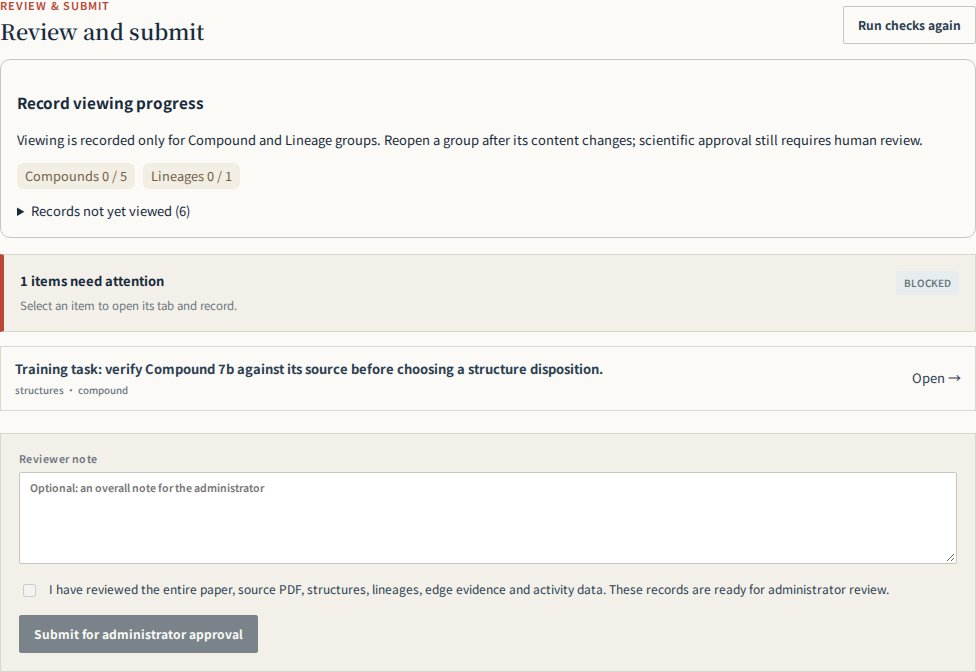

This teaching example intentionally retains a blocker. Open it and resolve the issue before final whole-paper confirmation.

For major article problems, use “Report an article problem and submit” with a required explanation. It can freeze incomplete or unconfirmed work, including viewing progress and blockers. An Admin can return it for follow-up; it cannot be published directly. Resolve the issue, complete normal review and resubmit.

## 16 · Troubleshooting: identify the issue first

Scientific edits use the Workspace version; on conflict reload and reconcile instead of overwriting others. Layout has its own revision; viewing does not increment scientific versions. Keep hints and drafts when unresolved; never confirm merely to pass submission checks.

| Situation | Recommended action |
|---|---|
| Label missing from Add Node | Check paper selection, existing membership and whether the Compound exists; avoid duplicates. |
| Diagram split into fragments | Distinguish layout from scientific relationships; inspect missing edges, wrong endpoints or grouping and retain source gaps. |
| Activity crop shows wrong row | Check row label, heading, unit and footnote; fix page/region and inspect the actual generated image. |
| Version conflict on save | Preserve unsaved text, reload current data and reconcile changes. Avoid concurrent editing of one paper in multiple windows. |
| Warning icon without text | Click to expand; viewing alone does not clear it. |
| Viewed becomes unread | Relevant content changed; inspect the current version, not the previous one. |
| Submission disabled | Locate each blocker: unread, draft, missing support, role issues or genuine source absence. |
| Read-only controls | Check role and workflow state; Admin viewing or submitted/approved content may be read-only. Ask for the normal change workflow. |
| Unfamiliar ring, stereochemistry or assay | Record compound label, PDF page, exact location and question for your supervisor; do not guess. |
| Source PDF fails to open or is temporarily unavailable | Retry; if it persists, report paper ID, title and the error to the supervisor. Keep source-dependent items pending when the source cannot be checked; do not delete or duplicate the paper to fix access. |

## 17 · A short practice exercise

This case is entirely fictional. Answer on paper without creating real database records. Think first, then expand the explanation.

Suppose compounds 7a, 7b and 7c share a scaffold with Me, OMe and F substituents. Their IC50 values in the same assay are 120, 40 and 15 nM. The authors explicitly compare 7b and 7c against 7a and select 7b for in vivo studies because of better exposure. Control Q appears only in the initial comparison, and synthesis includes labeled intermediate 6.

**Which identities belong in Compound?**

7a, 7b, 7c, Q and intermediate 6, provided each has a source-determinable structure. Missing activity does not exclude 6; Q does not need an artificial optimization edge.

**Should the graph be 7a→7b→7c?**

Do not chain by numbering. The explicit common reference supports SAR comparisons 7a→7b and 7a→7c. Synthetic relationships require the Scheme and cannot be inferred from these IC50 values.

**Which compound is prioritized by the paper?**

7b, explicitly advanced for its exposure. The lowest IC50 of 7c does not override the authors’ choice. Confirm that 7a is actually presented as the study/series starting point; being a reference alone is not always enough.

**How would IC50 <15 nM for 7c be entered?**

Metric=IC50, Operator=<, Value=15, Unit=nM; check the row, column and footnotes and retain conditions. Do not record it as exactly 15 or zero.

**Can you submit after clicking every group to viewed?**

No. Viewed does not establish scientific review. Resolve structure/edge/annotation dispositions, source issues and submission blockers, then give final whole-paper confirmation.

**Can Compound 3 be terminal in one graph and start the next optimization batch?**

Yes. Terminal means a local endpoint. If 3 becomes the baseline for a new batch, reuse the same Compound as root in the next graph and document the connection and support. A short chain can stay together with 3 as intermediate. A subsequent start is not automatically paper-prioritized; check author choice separately.

## 18 · Completion criteria and asking for help

A good review lets the next reader find the source, understand the judgment and see what remains unresolved.

1. Coverage: all identifiable, structurally determinable compounds checked; gaps and SI limits documented.
2. Identity and data: connectivity, rings, stereochemistry, Activity endpoint/value/unit/conditions checked against sources.
3. Relationships and roles: SAR/synthesis separated; groups and edges justified; local roles distinguished from author choices.
4. Traceability: pages, quotations and actual crops locate claims; uncertainties remain specific and are not cleared without evidence.
5. Handoff: current edits saved, viewing/dispositions truthful, Reviewer note explains unresolved scope, and final confirmation is yours.

```text
Help request (fictional)
Paper: TRAINING-001
Object: Compound 7b / Structure
Source: PDF p. 2, Scheme 1 and Table 1
Issue: the shared scaffold shows a six-membered N-containing ring; the current structure has five members. A wrong scaffold may have been used.
Checked: source label and substituent row; structure remains unconfirmed with a hint.
Needed: supervisor review of ring size and heteroatom position.
```

## 19 · Substituent abbreviation reference

Read source definitions and attachment points first. Case, prefixes and attachment atoms matter. Use your browser’s Find command (Ctrl+F / ⌘F).

| Symbol | Meaning | Check |
|---|---|---|
| Me | Methyl | –CH₃; OMe has an additional oxygen linkage. |
| Et | Ethyl | –CH₂CH₃ |
| n-Pr / i-Pr | n-Propyl / isopropyl | –CH₂CH₂CH₃ / –CH(CH₃)₂; attachment differs. |
| n-Bu / i-Bu / s-Bu / t-Bu | Butyl isomers | n-Butyl, isobutyl, sec-butyl, tert-butyl; not interchangeable. |
| Ph | Phenyl | –C₆H₅; attached directly through the aromatic ring. |
| Bn | Benzyl | –CH₂C₆H₅; one methylene more than Ph. |
| Be | Beryllium (element symbol) | Not a standard benzyl or phenyl abbreviation. Check the source definition or typography; do not silently replace with Bn/Ph. |
| OMe / OEt / OBn | Methoxy / ethoxy / benzyloxy | Attached through O; distinct from Me/Et/Bn. |
| Ac | Acetyl | –C(=O)CH₃; OAc is acetoxy. Preserve the attachment atom. |
| Boc | tert-Butoxycarbonyl | Common amine protecting group; preserve the actual attachment. |
| Cbz / Z | Benzyloxycarbonyl | Protecting group; not Bn. |
| Fmoc | Fluorenylmethoxycarbonyl | Protecting group; verify attachment in the drawing. |
| Ts / Ms / Tf | Tosyl / mesyl / triflyl | Distinguish from OTs/OMs/OTf and distinguish salts from covalent groups. |
| Ar / HetAr | Aryl / heteroaryl (generic) | Not a unique structure; resolve the definition and substitution positions. |
| R / R¹ / R² | Variable substituents | Expand only when assigned in the substituent table for that compound. |
| o- / m- / p- | Ortho / meta / para | Usually 1,2 / 1,3 / 1,4 on disubstituted benzene; verify numbering. |
| H / F / Cl / Br / I | Hydrogen / fluorine / chlorine / bromine / iodine | Element capitalization matters; Cl is not C plus I. |
| CF3 / CN / NO2 | Trifluoromethyl / cyano / nitro | Check attachment and valence; do not draw by character count. |
| c-Pr / c-Bu | Cyclopropyl / cyclobutyl | c- denotes a ring, distinct from acyclic Pr/Bu. |
| Py / pyridyl | Often pyridine / pyridyl, source-dependent | Resolve 2-/3-/4- attachment and N position; Py alone is not a unique structure. |
| TMS / TBDMS (TBS) / TBDPS | Common silyl protecting groups | Check silicon substituents and attachment; protection/deprotection changes the structure. |

[Reference: PDB identifier formats](https://www.rcsb.org/docs/general-help/identifiers-in-pdb)
